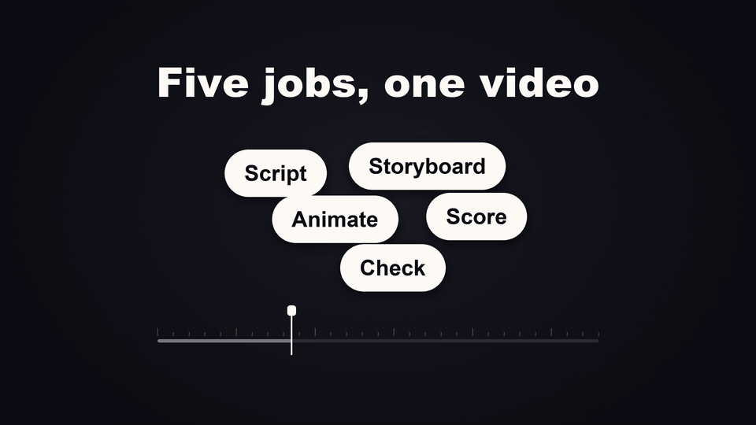

# Zoetrope

A Claude Code plugin that plans, scripts, animates, scores and renders short
videos end to end with Python, Pillow, numpy and ffmpeg (invoke as
`/zoetrope`): 40 style cards, a builder and a fresh-eyes reviewer agent, and
measured QA gates.

[](docs/zoetrope-promo.mp4)

The promo above was made with the skill itself, through the same storyboard, proof, two fresh-eyes reviews and gates as any other video. The GIF is a silent 960 px preview; it links to [the MP4](docs/zoetrope-promo.mp4) with sound (15 s, 1920x1080, -14.1 LUFS, 5.1 MB).

## Install

In Claude Code:

```text
/plugin marketplace add Sagargupta16/zoetrope
/plugin install zoetrope@zoetrope
```

Start a new session after installing, so the skill and the two agents (`zoetrope:zoetrope-builder`, `zoetrope:zoetrope-reviewer`) load. Then check the toolchain once: the skill runs `bash <skill>/setup.sh` on first use, which ends `SETUP: PASS` or prints one FIX line per gap.

## Requirements

- [uv](https://docs.astral.sh/uv/): every engine script runs as `uv run --no-project --with-requirements requirements.txt python ...`, with Pillow and numpy pinned and hashed and Python pinned in `engine/.python-version`. Nothing is installed globally.
- [ffmpeg](https://ffmpeg.org/) with libx264, and ffprobe beside it (Windows: `winget install Gyan.FFmpeg`; macOS: `brew install ffmpeg`; Debian or Ubuntu: `apt install ffmpeg`).
- A default font: Arial on Windows and macOS, Liberation Sans or DejaVu Sans on Linux (`fonts-liberation`, `fonts-dejavu-core`).
- Git Bash on Windows for `setup.sh` and the copy commands.

Optional, each fetched on demand into `~/.cache/zoetrope/`, pinned to one commit and checked by sha256 (each folder can be moved with its environment variable):

| What | Fetch | Size, license | Needed for |
| --- | --- | --- | --- |
| 14 free font families 24 cards name (Inter, Nunito, IBM Plex Mono and 11 more) | `python engine/fonts.py fetch` | 6.8 MB, SIL OFL | drawing those cards in their own type |
| Narration: Kokoro-82M (timestamped ONNX export) and its voices, in a side Python 3.13 environment | see `references/voice.md` | 325.5 MB plus 0.5 MB a voice, Apache-2.0 | a narrated video |
| Speech check: faster-whisper `base.en`, on the CPU in a side Python 3.14 environment | `python engine/qa_speech.py fetch` | 147.8 MB, MIT | checking what the narration says (Q806, Q807) |
| 14 recorded instruments from VSCO 2 CE and VCSL | `python engine/sampler.py fetch <names>` | 232.8 MB for all 14, CC0 1.0 | scores that play them |
| Blender 5.2.3 LTS as a Python module (`bpy`), into the uv cache, in a side Python 3.13 environment | `python engine/plate3d.py fetch` | 324 MB, GPL-3.0-or-later | 3D cards only; renders with Cycles, on the GPU when there is one |

The `fetch` paths are relative to the skill folder, `skills/zoetrope/`.

## How a video gets made


1. **Brief and style.** The main chat asks at most three questions (purpose, length and aspect, audio) and offers two or three of the 40 style cards.
2. **Storyboard gate.** A table of time, beat, visuals, text and audio. `qa.py holds` checks every line's reading time first; nothing is built until you approve it.
3. **Proof.** The `zoetrope-builder` agent copies `engine/`, writes `scenes.py` (one function per scene, a pure `draw(t)`, a registry of every text and cue) and runs `run_all.py proof`. The proof gates run on drawn frames: first frame, text registry, a purity check across processes and a lint. The run ends with one `PROOF:` line and the review sheets.
4. **Proof review.** The `zoetrope-reviewer` agent sees only the scenario and the sheets: numbered key cells, frame strips and the whole film as lanes on one time axis. `REVIEW FIX` goes back to the builder; `REVIEW PASS` goes to you for approval.
5. **Render.** `run_all.py full` pipes every frame into one H.264 encode, synthesizes and masters the sound, muxes, and runs every gate on the file. A clean file ends with an `APPROVAL:` line and one `DELIVERED` line; a failing one becomes `<name>.rejected.mp4`.
6. **Final review and approval.** A fresh reviewer checks the encoded file. `qa.py approve` binds that review to the file's content hashes, and `qa.py verify` must say `SAME` before delivery. Any later change reopens review by itself: `qa.py diff --expect` names exactly the frames and sound that changed.

The diagram's source is `docs/zoetrope-flow.workflow.json` (an archify workflow with source line references at commit `88153b5`, before the files moved under `skills/zoetrope/`).

## What is in it

| Part | What it does |
| --- | --- |
| Style cards | 40 style cards in `skills/zoetrope/references/styles/`, from 15 s product ads and logo stings to explainers, history films, game parodies, sketchbooks and one 3D character short. 34 were proven by a build; six (signal, ledger, blueprint, marquee, pulse, cartridge) were designed from the engine and pass `qa.py holds`. Six come with working code in `skills/zoetrope/kits/`. |
| Builder agent | Builds, renders and checks one video in its own context, so the engine and the logs stay out of the main chat (`agents/zoetrope-builder.md`). |
| Reviewer agent | Fresh eyes on the sheets and the file, never the builder's report; findings ranked P0, P1, P2 (`agents/zoetrope-reviewer.md`). |
| Drawing | `engine.py` helpers with one integer frame clock, `compile_schedule` for scenes, transitions and cues, nine pure transitions, seeded randomness. |
| Sound | Numpy instruments and 14 recorded ones (`sampler.py`: glockenspiel, marimba, harp, strings, flute, horn, timpani and percussion, all CC0), placed by their perceptual landmark (onset, peak, end or pad), a cue sheet and stems, and a 4x true-peak master to -14 LUFS. |
| 3D plates | A card can render its picture in Blender (Cycles on the GPU) as a plate that `scenes.py` reads like footage: real light, depth of field and a small character rig, under the same gates and approval (`plate3d.py`, `stage3d.py`, `references/plates.md`). `run_all.py` refuses a stale, unfinished or draft-quality plate. |
| Render | Frames pass from worker processes through shared memory into ffmpeg; no PNGs on disk. 45 fps on the template, BT.709 tagged. |
| QA gates | 60 coded checks (`qa.py check`): safe area, overlap, contrast, reading holds, WCAG 2.2 flashes, pops and freezes, true peak, what the narration says, cue sync on the stems, the mux, colour tags, size. |
| Approval | `approved/` keeps the hashes of what the reviewer passed; stale approval, regressions and changed frames are found mechanically. |
| Selftest | `qa.py selftest` plants a fault for every one of the 60 codes (161 fixtures) and proves each gate still catches it. |
| Narration | Offline narration in Kokoro's `af_heart` voice, one cached file per part with word times for cues (`voice.py`): respellings for names (`lexicon=`), exact pauses inside a line (`[pause 300ms]`), and lines held to their storyboard time (`fit=`). A speech model checks what it says (Q806 on the stem, Q807 in the file). |

## Run it

In a Claude Code session, ask for a video: `/zoetrope a 30 second launch video for <product>`. The skill does the rest and stops at the storyboard and proof for your approval. Videos land in `outputs/<slug>/` under your current folder unless you name another.

By hand, from a working folder that holds a copy of the engine (`cp -r skills/zoetrope/engine/. <folder>/`), each command run as `uv run --no-project --with-requirements requirements.txt python <command>`:

| Command | Result |
| --- | --- |
| `run_all.py proof --size 1920x1080` | Proof gates and review sheets; ends `PROOF: PASS`, `FIX` or `NOT CHECKED`. |
| `run_all.py full --size 1920x1080` | Frames, sound, master, mux and every gate; ends with `APPROVAL:` and `DELIVERED`. |
| `run_all.py audio` | Re-master and re-mux only, on the same picture. |
| `qa.py check out.mp4 --scenes . --size 1920x1080 --fps 30 --bpm 120` | Every gate on a finished file, one coded row each. |
| `qa.py speech narration/narration.json` | Q806 alone, right after narrating: each line transcribed by a speech model and held against its script. |
| `qa.py audiostrip out.mp4 --scenes .` | `review/audio.png`: spectrogram, loudness and cue timing for a reviewer who cannot hear. |
| `qa.py approve --review <reply>`, `qa.py diff --expect 2.5-5`, `qa.py verify` | Bind a review to the file, name what changed since, re-hash before delivery. |
| `qa.py selftest` | Every gate against its planted fault: `SELFTEST: PASS (161 fixtures, 60 of 60 codes covered, 0 expected gaps)`. |
| `plate3d.py render stage.py [--quality proof]`, `plate3d.py check --final` | Render a 3D plate for a build (half size for the proof, full for delivery), and ask whether every plate is current and final. |
| `python skills/zoetrope/engine/cards.py check` | The style router in SKILL.md, its kit list and every card count against the cards' `**Spec:**` lines: `CARDS: OK (40 cards ...)`. |
| `python scripts/check.py` | The repo gate: en or em dashes, secret-shaped strings, absolute home paths, the SKILL.md frontmatter, broken relative links in Markdown, JSON that does not parse, plugin manifest versions against the CHANGELOG head, and CR line ends. |

Each gate code, what it measures and its status on failure are in [qa-gates.md](skills/zoetrope/references/qa-gates.md); the engine's files and stages are in [engine.md](skills/zoetrope/references/engine.md).

## Layout

| Path | What |
| --- | --- |
| `.claude-plugin/` | `plugin.json` and `marketplace.json` (one plugin, `source: "./"`). |
| `skills/zoetrope/SKILL.md` | The skill: brief, style pick, storyboard and proof approvals, delivery, and the style router linking every card. |
| `skills/zoetrope/setup.sh` | First-use check of uv, ffmpeg with libx264 (found as the engine finds it) and ffprobe beside it, the Python pin in `engine/.python-version`, Pillow and numpy against their `requirements.in` pins, and the default font as the engine loads it. Safe to run again. |
| `skills/zoetrope/engine/` | The Python engine as real files. Drawing: `engine.py` (helpers, frame clock, `compile_schedule`), `scenes.py` (the per-video template), `transitions.py`, `grain.py`, `fonts.py` (the free fonts the cards name, by family), `plate3d.py` and `stage3d.py` (3D plates rendered by Blender). Sound: `audio.py` (template bed, cue sheet and stems, the true-peak master), `synth.py` (instruments, landmark placement), `sampler.py` (recorded CC0 instruments, fetched on demand), `voice.py` and `voice_samples.py` (offline narration). Build: `render.py` (frames piped into ffmpeg through shared memory), `run_all.py` (`proof`, `full`, `audio` stages), `proof.py` (review sheets). Checks: `qa.py` (the gate CLI: `check`, `look`, `holds`, `purity`, `lint`, `owner`, `approve`, `diff`, `verify`, `calib`, `speech`, `audiostrip`, `selftest`) with its gate modules `qa_scan.py`, `qa_stack.py`, `qa_sync.py`, `qa_speech.py`, `qa_registry.py`, `qa_approve.py`, `qa_purity.py`, `qa_lint.py`, `qa_audiostrip.py`, `qa_selftest.py` and `qa_fixtures/`. `cards.py` reads the style cards' spec lines and checks the router against them. `contract.py` is what they all share (frame clock, the QA row, file formats, the Q code table). `kit_index.py` lists every helper. `requirements.txt` pins Pillow and numpy with hashes and `.python-version` pins Python 3.15 for every build folder; `requirements-voice.in` lists the pins of the narration and speech check environments. The builder copies the folder into each video's working folder. |
| `skills/zoetrope/references/` | Small topic files (playbook, engine, formats, voice, music, instruments, plates, mixing, beat sync, house rules, QA gates, pitfalls, delivery report, troubleshooting). |
| `skills/zoetrope/references/styles/` | One file per style card (40) plus `families.md`, the intro each family shares. |
| `skills/zoetrope/kits/` | Working code from finished builds for six cards, one folder each with a README of what to reuse. |
| `agents/zoetrope-builder.md` | The agent the skill launches for build, proof sheet, render and the measured QA gates. |
| `agents/zoetrope-reviewer.md` | The fresh-eyes reviewer the skill launches after the proof and after the render: REVIEW PASS or REVIEW FIX with coded findings. |
| `scripts/check.py` | The repo gate (ZC001 to ZC008), no LLM: run it before every commit; CI runs it too. |
| `docs/` | The flow diagram (`zoetrope-flow.svg`) and its archify source, and the 15 s promo made with the skill (`zoetrope-promo.mp4`) with its GIF preview. These two are the only media committed: `.gitignore` lets `docs/*.mp4` and `docs/*.gif` through. |
| `.github/workflows/ci.yml` | The repo gate, and the engine self test on a fresh copy of the engine on Ubuntu. |
| `CHANGELOG.md` | Every change, with the reason. |
| `outputs/` | Videos made in this folder, gitignored (the promo in `docs/` is the one exception). |

Build lessons and repo rules for Claude are in `CLAUDE.md`; how to contribute is in [CONTRIBUTING.md](CONTRIBUTING.md), and how to report a vulnerability in [SECURITY.md](SECURITY.md).

## License

MIT, see [LICENSE](LICENSE). `stage3d.py` and every stage script call Blender's API (GPL-3.0-or-later); MIT is GPL-compatible. Fonts, models and recorded instruments keep their own licenses, listed in the references.

Every change, with its reason, is in [CHANGELOG.md](CHANGELOG.md).
