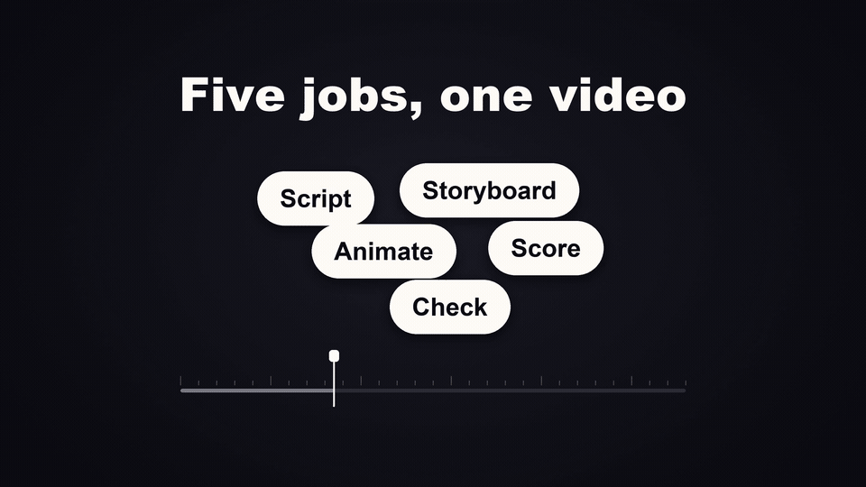

# Zoetrope

A Claude Code plugin that plans, scripts, animates, scores and renders short
videos end to end with Python, Pillow, numpy and ffmpeg (invoke as
`/zoetrope`): 41 style cards, a builder and a fresh-eyes reviewer agent, and
measured QA gates.

[](docs/zoetrope-promo.mp4)

The promo above was made with the skill itself, through the same storyboard, proof, two fresh-eyes reviews and gates as any other video. The GIF is a silent 960 px preview; it links to [the MP4](docs/zoetrope-promo.mp4) with sound (15 s, 1920x1080, -14.1 LUFS, 5.1 MB).

## Install

In Claude Code:

```text
/plugin marketplace add Sagargupta16/zoetrope
/plugin install zoetrope@zoetrope
```

Start a new session after installing, so the skill and the two agents (`zoetrope:zoetrope-builder`, `zoetrope:zoetrope-reviewer`) load. Then check the toolchain once: the skill runs `bash <skill>/setup.sh` on first use, which ends `SETUP: PASS` or prints one FIX line per gap.

## Requirements

- [uv](https://docs.astral.sh/uv/): every engine script runs as `uv run --no-project --with-requirements requirements.txt python ...`, with Pillow and numpy pinned and hashed and Python pinned in `engine/.python-version`. In a working folder that runs inside the `.venv` that `uv run --no-project python envs.py` built there, each wheel checked against its sha256 (`uv run` alone does not check them). Nothing is installed globally.
- [ffmpeg](https://ffmpeg.org/) with libx264, and ffprobe beside it (Windows: `winget install Gyan.FFmpeg`; macOS: `brew install ffmpeg`; Linux: a static build of ffmpeg 9.0 or newer, since older distro packages such as Ubuntu 24.04's 6.1 overshoot the true peak in the AAC encode enough to fail the template's loudness gate).
- A default font: Arial on Windows and macOS, Liberation Sans or DejaVu Sans on Linux (`fonts-liberation`, `fonts-dejavu-core`).
- Git Bash on Windows for `setup.sh` and the copy commands.

Optional, each fetched on demand into `~/.cache/zoetrope/`, pinned to one commit and checked by sha256 (each folder can be moved with its environment variable). Their side Python environments, Blender's included, are venvs in `~/.cache/zoetrope/envs/` built from exact-pinned locks, `engine/requirements-kokoro.txt`, `requirements-speech.txt` and `requirements-bpy.txt`, each wheel checked against the lock's sha256 (`engine/envs.py`):

| What | Fetch | Size, license | Needed for |
| --- | --- | --- | --- |
| 14 free font families 24 cards name (Inter, Nunito, IBM Plex Mono and 11 more) | `python engine/fonts.py fetch` | 6.8 MB, SIL OFL | drawing those cards in their own type |
| Narration: Kokoro-82M (timestamped ONNX export) and its voices, in a side Python 3.13 environment | see `references/voice.md` | 325.5 MB plus 0.5 MB a voice, Apache-2.0 | a narrated video |
| Speech check: faster-whisper `base.en`, on the CPU in a side Python 3.14 environment | `python engine/qa_speech.py fetch` | 147.8 MB, MIT | checking what the narration says (Q806, Q807) |
| 14 recorded instruments from VSCO 2 CE and VCSL | `python engine/sampler.py fetch <names>` | 232.8 MB for all 14, CC0 1.0 | scores that play them |
| Blender 5.2.4 LTS as a Python module (`bpy`, pinned in `engine/requirements-bpy.in`), in a side Python 3.13 environment | `python engine/plate3d.py fetch` | 324 MB, GPL-3.0-or-later | 3D cards only; renders with Cycles, on the GPU when there is one |

The `fetch` paths are relative to the skill folder, `skills/zoetrope/`.

## How a video gets made


1. **Brief and style.** The main chat asks at most three questions (purpose, length and aspect, audio) and offers two or three of the 41 style cards.
2. **Storyboard gate.** A table of time, beat, visuals, text and audio. `qa.py holds` checks every line's reading time first; nothing is built until you approve it.
3. **Proof.** The `zoetrope-builder` agent copies `engine/`, writes `scenes.py` (one function per scene, a pure `draw(t)`, a registry of every text and cue) and runs `run_all.py proof`. The proof gates run on drawn frames: first frame, text registry, a purity check across processes and a lint. The run ends with one `PROOF:` line and the review sheets.
4. **Proof review.** The `zoetrope-reviewer` agent sees only the scenario and the sheets: numbered key cells, frame strips and the whole film as lanes on one time axis. `REVIEW FIX` goes back to the builder; `REVIEW PASS` goes to you for approval.
5. **Render.** `run_all.py full` pipes every frame into one H.264 encode, synthesizes and masters the sound, muxes, and runs every gate on the file. A clean file ends with an `APPROVAL:` line and one `DELIVERED` line; a failing one becomes `<name>.rejected.mp4`.
6. **Final review and approval.** A fresh reviewer checks the encoded file. `qa.py approve` binds that review to the file's content hashes, and `qa.py verify` must say `SAME` before delivery. Any later change reopens review by itself: `qa.py diff --expect` names exactly the frames and sound that changed.

The diagram's source is `docs/zoetrope-flow.workflow.json` (an archify workflow with source line references at commit `d29e830`, 2.7.0, which added the optional image-plate step).

## What is in it

| Part | What it does |
| --- | --- |
| Style cards | 41 style cards in `skills/zoetrope/references/styles/`, from 15 s product ads and logo stings to explainers, history films, game parodies, sketchbooks and one 3D character short. 34 were proven by a build; six (signal, ledger, blueprint, marquee, pulse, cartridge) were designed from the engine and pass `qa.py holds`; one (deep-dive, 60 to 180 s narrated over photo plates) was written from our first six deep-dive builds. Six come with working code in `skills/zoetrope/kits/`. |
| Builder agent | Builds, renders and checks one video in its own context, so the engine and the logs stay out of the main chat (`agents/zoetrope-builder.md`). |
| Reviewer agent | Fresh eyes on the sheets and the file, never the builder's report; findings ranked P0, P1, P2 (`agents/zoetrope-reviewer.md`). |
| Drawing | `engine.py` helpers with one integer frame clock, `compile_schedule` for scenes, transitions and cues, nine pure transitions, seeded randomness, motion blur (sub-frames averaged in linear light), seeded noise and wobble, and 19 easings beside a spring. |
| Blocks | A library of ready blocks a builder drops into a scene, each a pure draw with its text-registry twin: lower thirds, word-synced captions, hand-drawn markers, end card, chat and notification cards, code typing and diffs (`blocks_text.py`); bar race, line, pie and donut, counter, ring, progress bar, route arc, audio visualizer (`blocks_data.py`); seven animated backgrounds, light leak, five more transitions and camera moves (`blocks_fx.py`). `blocks_preview.py` draws them all as a gallery (`references/blocks.md`). |
| Sound | Numpy instruments and 14 recorded ones (`sampler.py`: glockenspiel, marimba, harp, strings, flute, horn, timpani and percussion, all CC0), placed by their perceptual landmark (onset, peak, end or pad), a cue sheet and stems, and a 4x true-peak master to -14 LUFS. |
| 3D plates | A card can render its picture in Blender (Cycles on the GPU) as a plate that `scenes.py` reads like footage: real light, depth of field and a small character rig, under the same gates and approval (`plate3d.py`, `stage3d.py`, `references/plates.md`). `run_all.py` refuses a stale, unfinished or draft-quality plate. |
| Image plates | Photo-like pictures (planets, landscapes, food) from an image model run before the build, a local FLUX.1 schnell through ComfyUI (about 15 s a plate on an 8 GB laptop GPU) or a hosted Space; the engine animates them and draws every word and number on top (`references/image-plates.md`). |
| Render | Frames pass from worker processes through shared memory into ffmpeg; no PNGs on disk. 45 fps on the template, BT.709 tagged. |
| QA gates | 62 coded checks (`qa.py check`): safe area, overlap, contrast, reading holds, WCAG 2.2 flashes, pops and freezes, motion that reverses across a cut, whether the facts of a `quiz.json` are on screen, true peak, what the narration says, cue sync on the stems, the mux, colour tags, size. |
| Approval | `approved/` keeps the hashes of what the reviewer passed; stale approval, regressions and changed frames are found mechanically. |
| Selftest | `qa.py selftest` plants a fault for every one of the 62 codes (177 fixtures), proves each gate still catches it, and compares template frames with a golden set by PSNR. |
| Narration | Offline narration in Kokoro's `af_heart` voice, one cached file per part with word times for cues (`voice.py`): respellings for names (`lexicon=`), exact pauses inside a line (`[pause 300ms]`), and lines held to their storyboard time (`fit=`). A speech model checks what it says (Q806 on the stem, Q807 in the file). Two hosts on one timeline by naming a voice per line. |

## Run it

In a Claude Code session, ask for a video: `/zoetrope a 30 second launch video for <product>`. The skill does the rest and stops at the storyboard and proof for your approval. Videos land in `outputs/<slug>/` under your current folder unless you name another.

By hand, from a working folder that holds a copy of the engine (`cp -r skills/zoetrope/engine/. <folder>/`, then `uv run --no-project python envs.py` there once), each command run as `uv run --no-project --with-requirements requirements.txt python <command>`:

| Command | Result |
| --- | --- |
| `run_all.py proof --size 1920x1080` | Proof gates and review sheets; ends `PROOF: PASS`, `FIX` or `NOT CHECKED`. |
| `run_all.py full --size 1920x1080` | Frames, sound, master, mux and every gate; ends with `APPROVAL:` and `DELIVERED`. |
| `run_all.py audio` | Re-master and re-mux only, on the same picture. |
| `run_all.py draft` | A quick low-size motion preview to `draft.mp4`; the build files stay as they were. |
| `run_all.py full --loudness podcast`, `run_all.py alpha`, `run_all.py batch --sizes 1920x1080,1080x1920 full` | A loudness target (youtube, podcast, broadcast or a number), a transparent WebM or MOV from `draw_rgba(t)`, and one build per size in `variants/`. |
| `qa.py check out.mp4 --scenes . --size 1920x1080 --fps 30 --bpm 120` | Every gate on a finished file, one coded row each. |
| `qa.py speech narration/narration.json` | Q806 alone, right after narrating: each line transcribed by a speech model and held against its script. |
| `qa.py audiostrip out.mp4 --scenes .` | `review/audio.png`: spectrogram, loudness and cue timing for a reviewer who cannot hear. |
| `qa.py approve --review <reply>`, `qa.py diff --expect 2.5-5`, `qa.py verify` | Bind a review to the file, name what changed since, re-hash before delivery. |
| `qa.py selftest` | Every gate against its planted fault: `SELFTEST: PASS (177 fixtures, 62 of 62 codes covered, 0 expected gaps)`. `--bless` rewrites the golden frames after an intended change. |
| `plate3d.py render stage.py [--quality proof]`, `plate3d.py check --final` | Render a 3D plate for a build (half size for the proof, full for delivery), and ask whether every plate is current and final. |
| `python skills/zoetrope/engine/cards.py check` | The style router in SKILL.md, its kit list and every card count against the cards' `**Spec:**` lines: `CARDS: OK (41 cards ...)`. |
| `python scripts/check.py` | The repo gate: en or em dashes, secret-shaped strings, absolute home paths, the SKILL.md frontmatter, broken relative links in Markdown, JSON that does not parse, plugin manifest versions against the CHANGELOG head, and CR line ends. |

Each gate code, what it measures and its status on failure are in [qa-gates.md](skills/zoetrope/references/qa-gates.md); the engine's files and stages are in [engine.md](skills/zoetrope/references/engine.md).

## Studio

A second engine, `skills/zoetrope/studio/`, for narrated films drawn on an HTML stage instead of with Pillow: each frame is a page in headless Chrome that is a pure function of time, over stills and clips made on a local ComfyUI (Z-Image Turbo, LTX-2.5), with a Kokoro voice, captions lit word by word and 13 overlay types plus 22 drawn devices. A style lint (18 rules, `L01` to `L18`) and a per-still checklist (`C1` to `C6`) run before any reader sees the film, and one command line, `studio.py`, takes a film from script to a packaged file. It needs Chrome, playwright (pinned in `studio/requirements.in`), ffmpeg and ComfyUI; the audio comes from a copy of `engine/`.

```text
python skills/zoetrope/studio/studio.py new-batch outputs/<batch> --config skills/zoetrope/studio/batch.example.json
python outputs/<batch>/studio/studio.py new outputs/<batch> 01-slug --title "..." --topic "..."
python outputs/<batch>/studio/studio.py check outputs/<batch>/builds/01-slug all
```

`studio.py` starts its pinned environment through uv for the commands that need playwright, Pillow or numpy. Each batch copies the studio, so a kit change moves pixels only in new batches. Exit codes are 0 PASS, 1 FIX, 2 NOT CHECKED or a missing input, 3 refused and 64 a wrong argument; a check, `render` or `package` refuses (3) while `timeline.json` is older than its inputs, so run `build` again after any change. The manual is [references/studio.md](skills/zoetrope/references/studio.md) (pipeline, every command, `batch.json`, the shot JSON, every device with its settings, the house rules) and the rule list is [references/studio-checklist.md](skills/zoetrope/references/studio-checklist.md). `python -I skills/zoetrope/studio/selftest.py --quick` checks the engine itself.

## Layout

| Path | What |
| --- | --- |
| `.claude-plugin/` | `plugin.json` and `marketplace.json` (one plugin, `source: "./"`). |
| `skills/zoetrope/SKILL.md` | The skill: brief, style pick, storyboard and proof approvals, delivery, and the style router linking every card. |
| `skills/zoetrope/setup.sh` | First-use check of uv, ffmpeg with libx264 (found as the engine finds it) and ffprobe beside it, the Python pin in `engine/.python-version`, Pillow and numpy against their `requirements.in` pins, and the default font as the engine loads it. Safe to run again. |
| `skills/zoetrope/engine/` | The Python engine as real files. Drawing: `engine.py` (helpers, frame clock, `compile_schedule`), `scenes.py` (the per-video template), `transitions.py`, `grain.py`, `plates.py` (photo plates: Ken Burns shots, a cutout's parallax over its plate, depth blur, haze and vignette), `fonts.py` (the free fonts the cards name, by family), `plate3d.py` and `stage3d.py` (3D plates rendered by Blender), `footage.py` (video clips as plates), `blocks_text.py`, `blocks_data.py`, `blocks_fx.py` and `blocks_preview.py` (the block library and its gallery), `brand.py` (brand kits). Sound: `audio.py` (template bed, cue sheet and stems, the true-peak master), `synth.py` (instruments, ambience beds, landmark placement), `sampler.py` (recorded CC0 instruments, fetched on demand), `voice.py` and `voice_samples.py` (offline narration and its broadcast polish). Build: `render.py` (frames piped into ffmpeg through shared memory), `run_all.py` (`proof`, `full`, `audio` stages), `proof.py` (review sheets). Checks: `qa.py` (the gate CLI: `check`, `look`, `holds`, `purity`, `lint`, `owner`, `approve`, `diff`, `verify`, `calib`, `speech`, `audiostrip`, `selftest`) with its gate modules `qa_scan.py`, `qa_stack.py`, `qa_sync.py`, `qa_speech.py`, `qa_registry.py`, `qa_approve.py`, `qa_purity.py`, `qa_lint.py`, `qa_audiostrip.py`, `qa_quiz.py`, `qa_selftest.py` and `qa_fixtures/` (with `golden/`). `cards.py` reads the style cards' spec lines and checks the router against them. `contract.py` is what they all share (frame clock, the QA row, file formats, the Q code table). `kit_index.py` lists every helper. `requirements.txt` pins Pillow and numpy with hashes and `.python-version` pins Python 3.15 for every build folder; `requirements-kokoro.in`, `requirements-speech.in` and `requirements-bpy.in` pin the narrator's, the speech check's and Blender's side environments, locked with every dependency pinned in the matching `.txt`. `envs.py` builds each environment from its lock with `uv pip install --require-hashes`, so a wheel whose sha256 differs from the lock's is refused. The builder copies the folder into each video's working folder. |
| `skills/zoetrope/references/` | Small topic files (playbook, engine, formats, voice, music, instruments, plates, image plates, mixing, beat sync, house rules, QA gates, pitfalls, delivery report, troubleshooting). |
| `skills/zoetrope/studio/` | The studio engine: `studio.py` (the command line), `batch.py`, `build.py` (timeline), `gen.py` (ComfyUI stills and clips), `audio.py` (voice and mix), `render.py` (headless Chrome to H.264), `lint.py`, `checklist.py` and `qa.py` (the checks), `shotkit.py`, the stage and kit (`runtime.js`, `kit.js`, `kit_graphics.js`, CSS), `templates/`, `workflows/`, `comfy/` and `selftest.py`. |
| `skills/zoetrope/references/styles/` | One file per style card (41) plus `families.md`, the intro each family shares. |
| `skills/zoetrope/kits/` | Working code from finished builds for six cards, one folder each with a README of what to reuse. |
| `agents/zoetrope-builder.md` | The agent the skill launches for build, proof sheet, render and the measured QA gates. |
| `agents/zoetrope-reviewer.md` | The fresh-eyes reviewer the skill launches after the proof and after the render: REVIEW PASS or REVIEW FIX with coded findings. |
| `scripts/check.py` | The repo gate (ZC001 to ZC008), no LLM: run it before every commit; CI runs it too. |
| `docs/` | The flow diagram (`zoetrope-flow.svg`) and its archify source, and the 15 s promo made with the skill (`zoetrope-promo.mp4`) with its GIF preview. These two are the only media committed: `.gitignore` lets `docs/*.mp4` and `docs/*.gif` through. |
| `.github/workflows/ci.yml` | The repo gate, and the engine self test on a fresh copy of the engine on Ubuntu. |
| `CHANGELOG.md` | Every change, with the reason. |
| `outputs/` | Videos made in this folder, gitignored (the promo in `docs/` is the one exception). |

Build lessons and repo rules for Claude are in `CLAUDE.md`; how to contribute is in [CONTRIBUTING.md](CONTRIBUTING.md), and how to report a vulnerability in [SECURITY.md](SECURITY.md).

## License

MIT, see [LICENSE](LICENSE). `stage3d.py` and every stage script call Blender's API (GPL-3.0-or-later); MIT is GPL-compatible. Fonts, models and recorded instruments keep their own licenses, listed in the references.

Every change, with its reason, is in [CHANGELOG.md](CHANGELOG.md).
